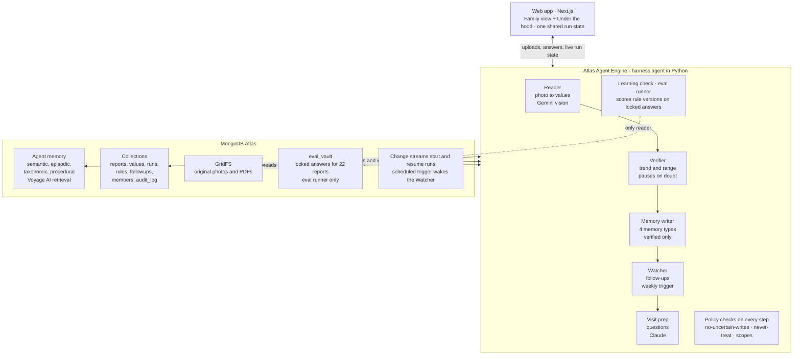

# Amma's Health: Engineering Plan

Oct 11, 2026 · Sreeprasad

## Goal and scope

Build Concept 4 as a working app in one hackathon day: a family health record that reads lab reports, remembers them for months, learns from corrections, and proves every step. The demo must survive one live run: upload a report, answer one question, show the harness learned.

**Two screens, one shared run state**

- **Family view:** body map with a story per area, trends with normal range, every report side by side, watch list, questions for the next visit.
- **Under the hood:** agent pipeline with traces, verifier, memory writes by type, learning check, watcher across weeks, governance log.

**In scope:** upload of a photo or PDF, extraction, verification with a human pause, the four Agent Engine memory types, a learning check on a frozen set, scoped family access, a policy that blocks treatment advice.

**Out of scope:** real patient data (synthetic reports only), diagnosis, mobile app, real hospital integration, multi-patient support.

**Assumptions:** one build day of about 8 hours, a team of 1–2, free tiers plus Atlas credits, within a $20/month cap.

## Theme and requirements

The brief asks for harnesses that adapt, remember and run reliably in production, built on MongoDB Atlas and Atlas Agent Engine. Every requirement below must be visible on screen during the demo, not just claimed in the pitch.

| Requirement from the brief | How we prove it on screen | Screen | Milestone |
| --- | --- | --- | --- |
| Memory: semantic, episodic, taxonomic, procedural | Each write is labelled by type in Memory writes; the family view reads from all four | Both | M3 |
| Retrieval powered by Voyage AI | Past values, doctor notes and terms found by hybrid search when a new report arrives | Under the hood | M3 |
| Adapt: self-evolving harness | Your correction becomes rule v4; the agent's own v4-alt is rejected | Under the hood | M5 |
| Reliable in production | Run pauses durably on a low-confidence value and resumes after restart | Both | M2 |
| Context across weeks-long tasks | Watcher tracks doctor follow-ups from Jan to Oct and wakes on a schedule | Under the hood | M6 |
| Governance | Policies hold uncertain writes and block treatment advice; every event logged with an identity | Under the hood | M6 |
| Security | Family scopes (aide sees medications only); encrypted health fields; synthetic data only | Both | M6 |
| Built on Atlas Agent Engine | Agents run on the Agent Engine runtime; session IDs link to its Traces page | Under the hood | M1, M7 |

**What past finalists were rewarded for**, and how this plan answers it:

- **A real person with a real problem** (Ripple, CyclopsDiary, Sightline): one family managing a parent's reports.
- **Proof, not claims** (all six): every value links to its source; the learning check uses locked answers, like Sightline.
- **A gate on self-improvement** (Offload, Recursive Computer Use): zero-regression check on 22 frozen reports.
- **One headline number** (Da Vinci's 83.5 g → 30.3 g): reading accuracy 98.4% → 100% with 0 regressions.
- **Atlas features each given a job**: Agent Engine memory and runtime, Voyage retrieval, change streams, GridFS, field-level encryption.

## Architecture

One Python harness agent on Atlas Agent Engine runs five steps; Atlas holds every report, memory and run. Policies and a locked answer set sit outside the agents' reach.

The web app talks only to the harness; the agents read and write Atlas, except `eval_vault`, which only the eval runner's database user can read.

| Part | Choice | Why |
| --- | --- | --- |
| Reading photos | Gemini, vision, free tier | Structured JSON per value with page and box |
| Reasoning, visit prep, policy check | Claude API | Short, careful drafts and a second-opinion check |
| Embeddings and retrieval | Voyage AI via Agent Engine memory | Built into the memory SDK; hybrid search with `$rankFusion` for the UI |
| Agent runtime and traces | Atlas Agent Engine, Python, `agentengine` CLI | The sponsor's platform; session IDs link to its Traces page |
| Run state and resume | `runs` collection + change streams | Checkpoint per step; an answer resumes the run |
| Originals | GridFS | Every value links back to its page |
| Web app | Next.js on Vercel | Matches the Concept 4 design; live run state |
| Budget | Free tiers + event credits | Stays inside $20 a month; memory costs about $0.25 per 1,000 docs stored |

## Milestones

Eight milestones, M0 before the event and M1–M7 on the day. Each ends with a check you can run in under a minute; do not start the next until it passes.

### M0 · Prep before the event (about 3 h)

Check the event rules first: if pre-written code is not allowed, do only steps 1–4.

1. Create the Atlas project, a Voyage AI key, a Gemini key and a Claude key; note each free-tier limit.
2. Install Docker, Python 3.11+ and the `agentengine` CLI; run `agentengine auth login` and pin the CLI version.
3. Run the Hello World quick start once (`agentengine create`, `agentengine dev up`) so the 5–10 minute build holds no surprises.
4. Ask the organizers for Atlas credits: the CLI provisions a paid Flex cluster by default.
5. Generate 23 synthetic lab reports for one fictional patient: 5 visits, about 380 values, a generic layout, never real data.
   1. Write ground truth as JSON per report: test, value, unit, range, page, box.
   2. Render to PDF and phone-style photos (tilt, blur, one smudged LDL digit on the Sep 12 report).
   3. Plant two real jumps in older reports, so a "snap to trend" rule genuinely fails the learning check.
6. Write five doctor notes with follow-ups (Jan 8, Mar 14 ×2, Jul 22, Oct 22).

**Done when:** the quick start answers a curl call, and the 23 reports plus truth files sit in one folder.

### M1 · Skeleton and data model (H0–H1)

1. Scaffold one Agent Engine project (`agentengine create`, memory on) with a single `harness` agent in Python.
2. Scaffold the web app: Next.js with the Concept 4 design tokens and two empty screens behind the Family view / Under the hood switch.
3. Create the Atlas collections: `reports`, `values`, `runs`, `rules`, `followups`, `audit_log`, `members`; originals go to GridFS.
4. Put truth files for the 22 older reports in a separate database `eval_vault`, readable only by the eval runner's database user.
5. Seed members: you and your sister (full), home aide (medications only).

**Done when:** the app shows both empty screens, and the agent's database user gets "unauthorized" reading `eval_vault`.

### M2 · Reader and Verifier with a durable pause (H1–H2.5)

1. Upload endpoint: store the file in GridFS, insert a `reports` doc; a change stream on `reports` starts a run.
2. Reader: Gemini vision returns structured JSON per value with page, box and confidence.
3. Verifier: compare each value with the patient's trend and the printed range; mark `verified` or `needs_person`.
   1. Rule: below 0.8 confidence and more than a 50% jump from trend → `needs_person`.
   2. Save a checkpoint to `runs` after every step.
4. Pause: the run stops at `needs_person`; an `answers` insert (change stream) resumes it from the checkpoint.
5. Restart test: kill the worker mid-pause, start it again, answer, and the run completes without redoing the Reader.

**Done when:** the Sep 12 photo yields 22 verified values and 1 paused LDL, and the kill-and-resume test passes.

### M3 · Memory writer and retrieval (H2.5–H3.5)

1. Use the standalone memory SDK bound to `user_id="amma"`, so memory never merges into a shared service-account scope.
2. Write each memory type with its job:
   1. Semantic: one fact per test, the current value (`save_semantic`), older values kept in `values` as history.
   2. Episodic: one episode per visit with the doctor's note (`save_episode`).
   3. Taxonomic: printed names mapped to standard ones, project-wide (`save_taxonomic`, domain `lab-tests`).
   4. Procedural: the reading rules for this report layout (`save_procedure`), opt-in in `build_context`.
3. Policy `no-uncertain-writes`: the writer refuses any value not `verified`; the refusal goes to `audit_log`.
4. Retrieval: `build_context` with all four sources for the agents; hybrid search over `values` and notes with Voyage embeddings and `$rankFusion` for the UI.

**Done when:** a search for "HGB" returns Hemoglobin history, and a paused value is provably absent from memory.

### M4 · Family view (H3.5–H4.5)

1. Body map: six areas, status from the latest facts (rising, low, improving, steady).
2. Area story: trend chart with the normal-range band, questions and source links into the original report page.
3. Every-report grid from `values`; a pending value shows as "? check".
4. New-report banner with the paper view, highlight on select, and the confirm buttons that write to `answers`.
5. Live updates: the UI subscribes to run state, so confirming flips both screens without a reload.

**Done when:** confirming LDL on the family view updates the chart, the grid and the banner within 3 seconds.

### M5 · Learning check (H4.5–H5.5)

1. Store rules as versions in `rules` (v3 live) and mirror the live one into procedural memory.
2. From your answer, the agent drafts rule v4; it also proposes its own v4-alt ("snap to trend").
3. Eval runner: re-read the 22 older reports with each candidate and score against `eval_vault`.
4. Gate: promote only if correct values do not fall and zero values that v3 got right turn wrong.
5. Write the result to `rules` and `audit_log`; the promoted rule replaces the procedural memory.

**Done when:** v4-alt is rejected with 2 regressions and v4 is promoted at 380 / 380, computed live, not hard-coded.

### M6 · Watcher, governance and security (H5.5–H6.5)

1. Watcher: extract follow-ups from doctor notes into `followups`; match them against later reports and visits.
2. Schedule it weekly with an Atlas scheduled trigger; add a "run now" button for the demo.
3. Visit prep: draft questions with Claude from `build_context`.
4. Policy `summarize-never-treat`: a check on every draft; treatment advice is blocked and rewritten as a question.
5. Scopes: every API call checks `members`; the aide's request for lab values is denied and logged.
6. Encrypt values and notes at the field level; if setup runs long, fall back to explicit encryption of note text.

**Done when:** the log shows HELD, BLOCKED, DENIED and REJECTED events, each with an identity.

### M7 · Under the hood and demo hardening (H6.5–H8)

1. Pipeline cards read from `runs`: status, duration and the Agent Engine session ID that opens its Traces page.
2. Memory writes, learning check, watcher and governance log, all from live collections.
3. Replay: one endpoint resets the Sep 12 run and the rules to v3.
4. Deploy with `agentengine deploy`; raise `scaling.replicas` above 4 before the build; keep `agentengine dev up` as a local fallback.
5. Record a 2-minute screen capture of a clean run as the last-resort backup.
6. Rehearse the script three times; time each run.

**Done when:** three clean runs in a row, each under 2 minutes, on the deployed app.

## Timeline and cuts

The day runs eight hours, with features frozen at H6.5 so the last 90 minutes go to deploy, replay and rehearsal.

```mermaid
gantt
  title Hackathon day by hour from the start (M0 happens before the event)
  dateFormat HH:mm
  axisFormat H%H
  section Build
  M1 Skeleton                   :m1, 00:00, 60m
  M2 Reader + Verifier          :m2, after m1, 90m
  M3 Memory + retrieval         :m3, after m2, 60m
  M4 Family view                :m4, after m3, 60m
  M5 Learning check             :m5, after m4, 60m
  M6 Watcher + governance       :m6, after m5, 60m
  Feature freeze                :milestone, freeze, after m6, 0m
  section Harden
  M7 Under the hood + demo      :m7, after m6, 90m
```

**If behind, cut in this order** (the demo still tells the full story after each cut):

1. Field-level encryption → show scopes and the access log only.
2. Scheduled trigger for the Watcher → keep the "run now" button.
3. Hybrid `$rankFusion` search in the UI → use `build_context` results only.
4. Deployed agent → run `agentengine dev up` on the laptop.
5. Live photo upload → pre-uploaded Sep 12 report with the pause still live.

**Never cut:** the durable pause, the learning check with real scores, and the governance log. Those three are the theme.

## Risks, open questions and demo script

The biggest risk is the preview platform, not the code: Agent Engine is in public preview with breaking changes expected, so every Atlas-side step has a local fallback.

| Risk | Likelihood | Fallback |
| --- | --- | --- |
| Agent Engine build or deploy fails on the day (5–20 min per build) | Medium | Run with `agentengine dev up` locally; demo from the laptop |
| Deployed agent shares one memory scope across users via service account | High if deployed | Standalone memory SDK with explicit `user_id` (M3 step 1) |
| Traces visible only in the Agent Engine UI, no trace API documented | High | Own step log in `runs`; link each run to its Agent Engine session ID |
| Gemini misreads a clean value live | Medium | Pre-run the Sep 12 report once; replay uses the cached reading |
| Field-level encryption setup eats an hour | Medium | Explicit encryption of note text only (M6 step 6) |
| Free-tier rate limits during rehearsal | Low | Cache Reader output per report hash |
| Sandbox pool full with 4 replicas | Low | Raise `scaling.replicas` before the build; reuse session IDs |

**Open questions**

- Does the event allow code written before the start? This decides how much of M0 happens early.
- Will organizers provide Atlas credits for the Flex cluster?
- Team size: with two people, split M2–M3 (backend) from M4 (family view) at H1.

**Demo script, 2 minutes**

1. **0:00** · "My mother has 23 lab reports from 5 visits. Nobody in my family can say what changed since March."
2. **0:20** · Family view: tap Blood sugar, show the rising trend and the doctor's March note.
3. **0:40** · Upload the Sep 12 photo; the run pauses on one smudged value instead of guessing.
4. **1:00** · Answer "104"; chart, grid and banner update together.
5. **1:15** · Under the hood: the agent's own rule rejected for 2 regressions; yours promoted at 380 / 380.
6. **1:35** · Governance log: treatment advice blocked, aide denied, uncertain write held.
7. **1:50** · Close on the headline: "Memory that proves itself, learns from the family, and never advises treatment."
